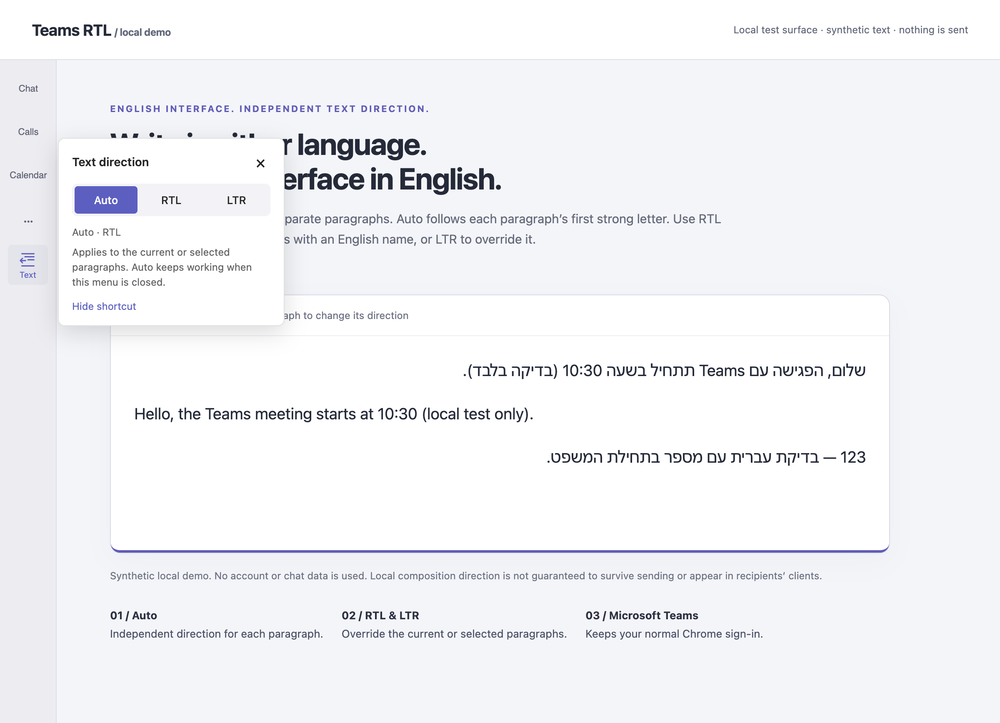
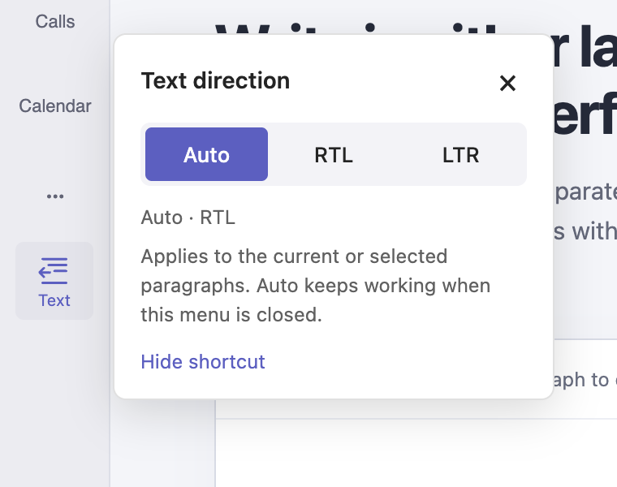
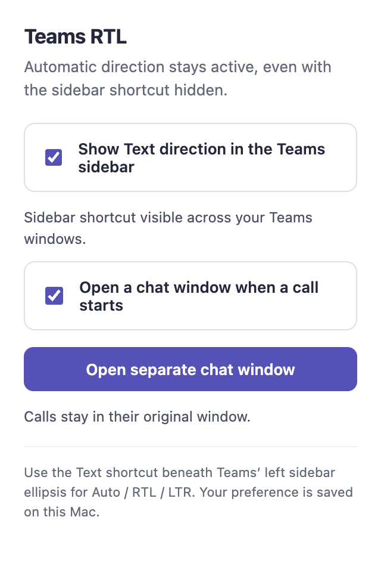
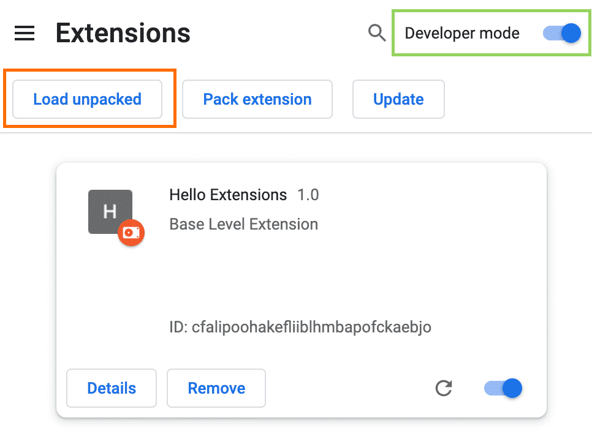

# teams-web · Teams RTL

**Keep Microsoft Teams in English. Write Hebrew and English in the right direction.**

An open-source Chrome extension with automatic paragraph direction, a small Teams sidebar menu, and a separate chat window during calls. Includes an optional lightweight Mac launcher named **teams-web**.

[Download the Mac installer](https://github.com/markes76/teams-web-rtl/releases/latest) · [Illustrated setup guide](docs/INSTALL.md) · [Requirements](docs/REQUIREMENTS.md) · [Report an issue](https://github.com/markes76/teams-web-rtl/issues)



*The screenshot above uses the actual direction controls on a local demo with synthetic text. It is not a live Teams chat.*

## Why this exists

The requirement came from daily use of Teams in English: Hebrew paragraphs needed correct right-to-left composition without changing all of Teams’ menus to Hebrew. The controls also needed a permanent home in the left sidebar, without covering the composer. During a call, a second window should keep text conversations accessible.

This project adds those local conveniences to Teams web while Chrome handles Microsoft sign-in, passkeys, media permissions and the browser session. It is a community beta, not an official Microsoft client.

## Features

- **Auto per paragraph:** follows the first strong letter, ignoring leading numbers and punctuation.
- **Manual RTL / LTR:** override the current paragraph or a selection; Auto clears the override.
- **Sidebar menu:** enable a small **Text** shortcut below the left rail’s **…**. Auto works with the menu closed or the shortcut hidden.
- **Chat during calls:** automatically open or focus a companion Teams chat window; a manual button is available too.
- **Optional Mac app:** a small launcher opens Chrome’s installed Teams web app when available, otherwise a Chrome app window. No embedded Electron runtime is installed.

| Direction menu | Extension settings |
| --- | --- |
|  |  |

## Install

1. [Download the latest release](https://github.com/markes76/teams-web-rtl/releases/latest) and unzip **teams-web-rtl-0.1.0-mac.zip**.
2. Double-click **Install.command**. No Node.js, Xcode or administrator access is needed. The script is readable before you run it.
3. In your Teams Chrome profile, type `chrome://extensions`, enable **Developer mode**, then choose **Load unpacked** and select `~/Library/Application Support/teams-web/extension`.
4. Open **teams-web** from your home Applications folder and sign in normally. Open the **Teams RTL** extension popup to enable **Show Text direction in the Teams sidebar** if you want manual controls.



*Chrome’s official setup screenshot, reproduced unchanged from its [Load unpacked guide](https://developer.chrome.com/docs/extensions/get-started/tutorial/hello-world#load-unpacked). Google, CC BY 4.0. Exact appearance varies by Chrome version.*

Chrome requires this manual extension step; the installer does not alter browser profiles or silently enable extensions. See [the illustrated installation guide](docs/INSTALL.md) for updates, uninstalling, managed devices and macOS download restrictions.

**Other platforms:** download **teams-rtl-0.1.0-extension.zip**, unzip it to a permanent folder, then load its `extension` folder through Chrome’s Developer mode. The extension is intended for desktop Chrome; the installer is Mac-only. Windows and Linux have not been tested on real Teams accounts.

## What to expect

The English interface stays English. Hebrew paragraphs align RTL, English paragraphs align LTR. A Hebrew paragraph that begins with an English name such as “Teams” follows that first letter, so choose **RTL** manually when needed.

**This improves local composition. It does not guarantee saved or recipient-side direction.** In a live self-chat check, per-paragraph DOM formatting did not survive sending and reloading. Teams’ editor and recipients’ clients control final rendering. Direction overrides last for the current paragraph DOM node, not across reloads.

The call feature opens a **chat companion**, not a native call pop-out. The call stays in its original window. Detection uses observed English call controls and known Teams identifiers, so Teams redesigns or localization may require changes. Multi-account setups, incoming calls and screen sharing have not been comprehensively validated.

## Privacy and permissions

The extension can read and modify pages on `teams.microsoft.com` and `teams.cloud.microsoft`. It needs that access to inspect editor paragraphs and apply direction. Its only named permission is `storage`.

There is no project backend, telemetry, data-upload code, credential copying or message archive. Preferences are stored in Chrome local storage; companion window IDs use session storage. The extension does not match Microsoft login pages. Teams and Chrome still communicate with their normal services. See [PRIVACY.md](PRIVACY.md).

## Develop

```sh
npm ci
npm test
npm run extension
```

`npm test` runs Node regression tests, installer checks on macOS, and local Chromium layout/selection tests. The Electron development dependency is only a local test harness; it is not the distributed Teams app. `npm start` opens the synthetic demo; `npm run screenshots` regenerates the original images and icons. `npm run release` creates the Mac/extension ZIPs and checksums on macOS. See [CONTRIBUTING.md](CONTRIBUTING.md).

Verified manually on one Mac/Chrome Teams account: mixed-language composition, sidebar controls and a companion window triggered by a call. Local regression checks cover direction, selection, editor replacement, context invalidation and companion reuse. This does not establish compatibility with every Teams tenant or browser release.

## License and attribution

Project code and original artwork: [MIT](LICENSE). Chrome setup screenshots: Google, [CC BY 4.0](https://creativecommons.org/licenses/by/4.0/), with [source details](docs/images/ATTRIBUTION.md). Microsoft Teams and Google Chrome are trademarks of their respective owners. This project is not affiliated with or endorsed by Microsoft or Google. The distributed icon is original artwork, not Microsoft’s Teams logo.
