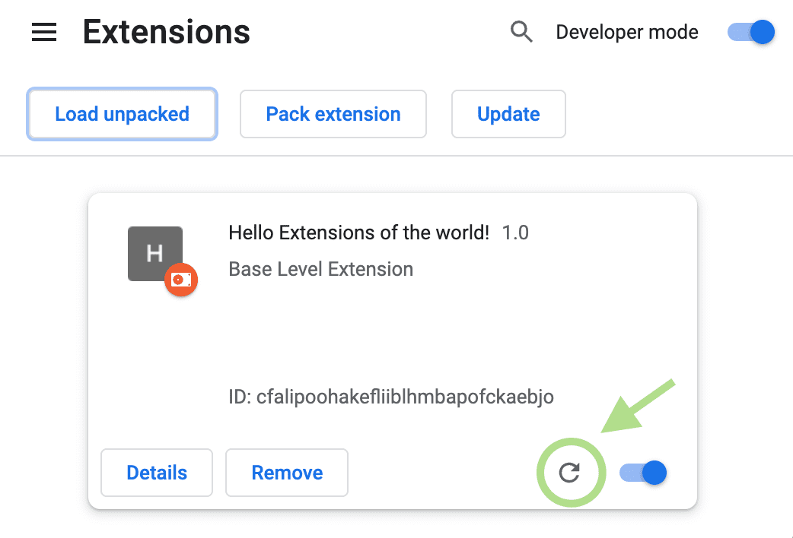

# Install teams-web and Teams RTL

## Requirements

- A Mac with Google Chrome installed for the optional launcher. The installer uses built-in macOS tools; no Node.js, Xcode or admin account is needed.
- A Microsoft Teams account that works in Chrome, and permission to use extensions on your device.
- Chrome’s Developer mode, because this beta is distributed as source rather than through the Chrome Web Store. Updates are manual.

The installer has been tested locally on the development Mac. Compatibility with older macOS releases has not been established. Organizations may prohibit unpacked extensions; ask your administrator rather than changing managed settings.

## 1. Download and prepare

Open [Releases](https://github.com/markes76/teams-web-rtl/releases/latest), download **teams-web-rtl-0.1.0-mac.zip**, and unzip it. Double-click **Install.command** in the extracted folder. Terminal shows the install locations and the next steps.

The installer creates:

| Item | Location |
| --- | --- |
| teams-web launcher | `~/Applications/teams-web.app` |
| Extension files, kept permanently | `~/Library/Application Support/teams-web/extension` |
| Local quick-start page | `~/Library/Application Support/teams-web/START-HERE.html` |

It opens Finder at the extension files and the quick-start page in your default browser. It does not modify your Chrome profiles or install the extension into Chrome for you. It refuses to overwrite an unrelated app. Once installed, you can delete the downloaded ZIP/extracted installer, but keep the extension folder in Application Support.

**If macOS blocks the downloaded command:** the package is not notarized. Review its source and follow your organization’s software policy. Do not disable Gatekeeper or remove quarantine attributes. You can skip the Mac installer and use the extension-only steps below. A Chrome Web Store release is not available yet.

## 2. Open Chrome’s Extensions page

In the **Chrome profile you use for Teams**, type `chrome://extensions` into the address bar. You can also use the puzzle-piece Extensions menu → **Manage Extensions**.

Turn on **Developer mode** at the upper right. Click **Load unpacked** at the upper left.


*Official Chrome documentation screenshot, Google, CC BY 4.0. It is reproduced unchanged; wording and layout may differ in your Chrome version.*

## 3. Select the installed extension

In the folder picker, press **Command–Shift–G**, paste:

```text
~/Library/Application Support/teams-web/extension
```

Press Return, then **Open/Select**. Choose the folder that contains `manifest.json`. Chrome should show **Teams RTL 0.1.0**.

Pin **Teams RTL** using Chrome’s Extensions menu if you want quick access to its settings.

## 4. Open Teams and choose your controls

Open **teams-web** in your home Applications folder. It opens the installed Chrome Teams PWA if it finds one at Chrome’s standard Teams location; otherwise it opens `teams.cloud.microsoft` in Chrome app mode. Chrome may still label the running window Microsoft Teams. You can drag teams-web to the Dock yourself.

Sign in through Microsoft normally. Keep Teams’ interface language English. The extension and Teams must be in the **same Chrome profile**. When using app-mode fallback with several profiles, open the intended Chrome profile before launching; if Chrome selects another profile, use Teams directly in the profile where you loaded the extension.

Auto direction runs without opening a menu. To show manual controls, click the **Teams RTL** extension icon and enable **Show Text direction in the Teams sidebar**.


In Teams, click **Text** beneath the left rail’s **…** to open **Auto / RTL / LTR**. The menu closes after a choice, Escape, or an outside click. Hiding the shortcut does not turn Auto off.


Leave **Open a chat window when a call starts** enabled to keep a text window available during calls. A manual **Open separate chat window** button is also available. Starting/accepting calls remains your action; the extension never joins, hangs up or toggles microphone/camera controls.

## Extension only: Windows, Linux or manual Mac setup

1. Download **teams-rtl-0.1.0-extension.zip** from Releases.
2. Unzip it to a permanent folder, not a temporary Downloads location you plan to delete.
3. Follow steps 2–3 above, selecting that extracted `extension` directory.
4. Reload Teams in the same Chrome profile. Use a normal Teams tab or Chrome’s own installed web app.

The Mac launcher is optional. Windows/Linux extension use is intended but has not been tested with a real Teams account on those platforms.

## Update

1. Download the new release and run its installer again. It updates the stable extension folder. For extension-only installs, replace the contents of the same folder you originally loaded.
2. Open `chrome://extensions` and click **Reload** on **Teams RTL**.
3. Finish or save your current draft and end any active call yourself, then refresh each Teams tab/app window.



*Official Chrome documentation screenshot, Google, CC BY 4.0. The example card is Chrome’s sample extension, not Teams RTL.*

Reloading an extension alone does not replace content scripts in an already-open Teams page. An old “Extension context invalidated” error means the page needs refreshing. The lifecycle guard removes stale controls rather than repeatedly calling an invalidated extension context.

## Troubleshooting

| Symptom | Check |
| --- | --- |
| No **Text** shortcut | Enable sidebar visibility in the extension popup; it starts hidden. Refresh Teams after first installation. |
| No automatic Hebrew direction | Confirm Teams and the extension are in the same Chrome profile, and the extension is enabled. |
| Hebrew line starts with an English word | Auto follows the first strong letter. Use RTL for that paragraph. |
| Call does not open another window | Try the popup’s manual button. Ensure automatic call opening is enabled. Teams may have changed its control identifiers. |
| No Developer mode / Load unpacked | Your browser may be managed. Follow your administrator’s policy. |
| Cannot select the extension | Select the directory with `manifest.json`, not the ZIP or the parent installer folder. |
| Direction changes after sending | This is a known limit: local DOM direction is not guaranteed to survive Teams serialization or recipient rendering. |

## Uninstall

1. Remove **Teams RTL** in `chrome://extensions`, then refresh Teams when no call is active.
2. Move `~/Applications/teams-web.app` to Trash.
3. Delete `~/Library/Application Support/teams-web` if you no longer need its files.

Your Chrome sign-in, chats, official Teams app and Chrome-installed PWA remain in place. Do not remove those to uninstall this project.

Sources: [Chrome Load unpacked and Reload instructions](https://developer.chrome.com/docs/extensions/get-started/tutorial/hello-world#load-unpacked), [Chrome alternative installation restrictions](https://developer.chrome.com/docs/extensions/how-to/distribute/install-extensions). Screenshot attribution: [images/ATTRIBUTION.md](images/ATTRIBUTION.md).
